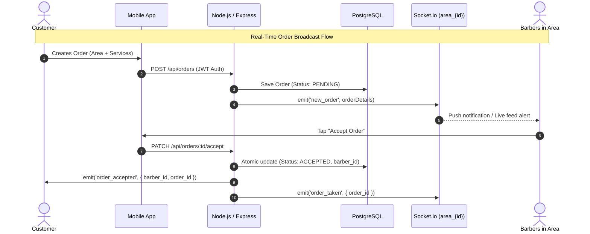
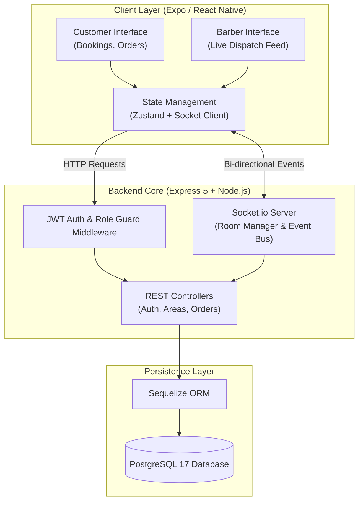
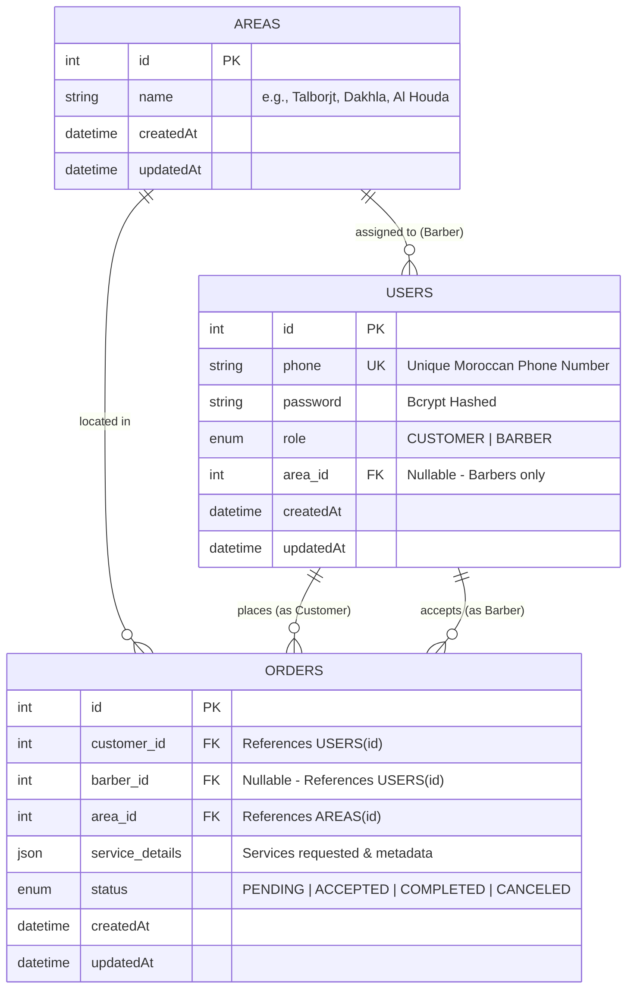

<div align="center">

# 💈 BARBERO
### Real-Time On-Demand Neighborhood Barber Booking Platform

*An inDrive-inspired dispatch platform connecting clients with local barbers for on-demand home grooming services.*

---

[](https://nodejs.org/)
[](https://expressjs.com/)
[](https://reactnative.dev/)
[](https://expo.dev/)
[](https://www.typescriptlang.org/)
[](https://www.postgresql.org/)
[](https://socket.io/)
[](LICENSE)

</div>

---

## 📌 Table of Contents

- [Overview](#-overview)
- [Key Features](#-key-features)
- [How It Works (inDrive-Style Dispatch)](#-how-it-works-indrive-style-dispatch)
- [System Architecture](#-system-architecture)
- [Tech Stack](#-tech-stack)
- [Project Structure](#-project-structure)
- [Database Schema](#-database-schema)
- [Getting Started](#-getting-started)
  - [Prerequisites](#prerequisites)
  - [1. Database Setup (Docker)](#1-database-setup-docker)
  - [2. Backend Setup](#2-backend-setup)
  - [3. Mobile App Setup (Expo)](#3-mobile-app-setup-expo)
- [API & WebSocket Documentation](#-api--websocket-documentation)
  - [REST Endpoints](#rest-endpoints)
  - [WebSocket Events & Rooms](#websocket-events--rooms)
- [Design System](#-design-system)
- [Contributing](#-contributing)
- [License](#-license)

---

## 📖 Overview

**BARBERO** is a hyper-local, real-time barber booking platform designed for effortless in-home grooming services. 

Unlike traditional platforms cluttered with complex maps and GPS trackers, **BARBERO** embraces an **inDrive-inspired broadcast model**:
1. Customers choose their neighborhood (Area) and specify desired services.
2. The order is instantly broadcast via WebSockets to all registered barbers currently operating in that specific zone.
3. Available barbers review and accept the request with a single tap.
4. The client is notified immediately, creating a frictionless connection.

Wrapped in an **ultra-minimalist dark mode** palette accented with calm sage green (`#8DA399`), BARBERO provides a premium, distraction-free booking experience.

---

## ✨ Key Features

- ⚡ **Real-Time Dispatch Engine**: Powered by Socket.io room broadcasting (`area_${id}` and `user_${id}`).
- 📍 **Hyper-Local Neighborhood Routing**: Fast zone-based matching eliminating tedious map pinning.
- 💈 **Dual-Role Architecture**:
  - **Customers**: Request home appointments, view live order statuses, review booking history.
  - **Barbers**: Receive instant job alerts for their neighborhood, accept requests in real time, and track assigned appointments.
- 🛡️ **Enterprise-Grade Security**:
  - JWT (JSON Web Tokens) with payload validation.
  - Salted password hashing via `bcrypt`.
  - Protected Barber registration with verification invite keys.
  - Input validation powered by `Zod`.
- 📱 **Cross-Platform Mobile App**:
  - Built with React Native & Expo Router.
  - Global state management with Zustand.
  - Optimized forms with React Hook Form + Zod resolvers.
- 🐳 **Docker-Ready**: Streamlined PostgreSQL 17 container configuration for instant local deployment.

---

## 🔄 How It Works (inDrive-Style Dispatch)



---

## 🏗️ System Architecture



---

## 🛠️ Tech Stack

| Domain | Technology | Details |
| :--- | :--- | :--- |
| **Mobile Frontend** | [React Native](https://reactnative.dev/) | Cross-platform runtime (v0.86) |
| | [Expo](https://expo.dev/) & [Expo Router](https://docs.expo.dev/router/introduction/) | SDK 57, file-based routing |
| | [TypeScript](https://www.typescriptlang.org/) | Type safety & strict contracts |
| | [Zustand](https://github.com/pmndrs/zustand) | Lightweight global store for Auth & Orders |
| | [React Hook Form](https://react-hook-form.com/) + [Zod](https://zod.dev/) | High-performance schema-based form validation |
| | [Lucide React Native](https://lucide.dev/) | Consistent, elegant iconography |
| **Backend API** | [Node.js](https://nodejs.org/) | JavaScript runtime (ES Modules) |
| | [Express.js](https://expressjs.com/) | v5.x REST framework |
| | [Socket.io](https://socket.io/) | v4.x WebSockets for real-time room communication |
| | [Sequelize](https://sequelize.org/) | Promise-based ORM with automatic migrations & seeders |
| | [JSON Web Tokens (JWT)](https://jwt.io/) & [bcrypt](https://github.com/kelektiv/node.bcrypt.js) | Secure authentication & authorization |
| **Database & DevOps**| [PostgreSQL](https://www.postgresql.org/) | Relational database (PostgreSQL 17) |
| | [Docker Compose](https://docs.docker.com/compose/) | Isolated local database environment |

---

## 📁 Project Structure

```text
Barbero-AI-Assistant-MVP-/
├── backend/                        # Server application
│   ├── src/
│   │   ├── config/                 # Database & environment configurations
│   │   ├── controllers/            # Business logic (auth, areas, orders)
│   │   ├── middleware/             # Auth guards, Zod validation, error handlers
│   │   ├── models/                 # Sequelize models (User, Area, Order)
│   │   │   └── associations/       # Relational foreign key bindings
│   │   ├── routes/                 # Express API route endpoints
│   │   ├── seeders/                # Default neighborhood/area seed data
│   │   ├── sockets/                # Socket.io connection & room handler
│   │   └── server.js               # Application entry point & HTTP/WS bootstrap
│   ├── docker-compose.yml          # PostgreSQL container definition
│   ├── package.json
│   └── .env.example                # Backend environment template
│
├── barbero-mobile/                 # Mobile client (React Native / Expo)
│   ├── app/                        # Expo Router screen tree
│   │   ├── (tabs)/                 # Bottom navigation tabs (Orders, Bookings, Profile)
│   │   ├── barber-home.tsx         # Barber live incoming orders feed
│   │   ├── customer-home.tsx       # Customer booking creation dashboard
│   │   ├── login.tsx & register.tsx# Authentication flows
│   │   └── order/[id].tsx          # Order details & tracking screen
│   ├── components/                 # Reusable UI components & atoms
│   ├── constants/                  # Color palettes, typography & theme tokens
│   ├── schemas/                    # Client-side Zod validation schemas
│   ├── services/                   # Axios API clients & Socket service
│   ├── stores/                     # Zustand state stores (auth, orders)
│   └── package.json
│
└── README.md
```

---

## 🗄️ Database Schema



---

## 🚀 Getting Started

### Prerequisites

Ensure you have installed:
- [Node.js](https://nodejs.org/) (v18.x or later) & [npm](https://www.npmjs.com/)
- [Docker](https://www.docker.com/) & [Docker Compose](https://docs.docker.com/compose/) (or a local PostgreSQL instance)
- [Expo Go](https://expo.dev/go) on your mobile device (iOS/Android) or an emulator

---

### 1. Database Setup (Docker)

Spin up the pre-configured PostgreSQL 17 container:

```bash
cd backend
docker compose up -d
```

> **Note:** Edit `backend/docker-compose.yml` to specify your preferred password and port if needed.

---

### 2. Backend Setup

1. **Navigate to the backend directory and install dependencies:**
   ```bash
   cd backend
   npm install
   ```

2. **Configure Environment Variables:**
   Create a `.env` file in the `backend/` directory:
   ```env
   PORT=3000
   DB_HOST=localhost
   DB_PORT=5432
   DB_NAME=barbero_db
   DB_USER=barbero
   DB_PASSWORD=your_secure_password
   JWT_SECRET=your_super_secret_jwt_key
   BARBER_INVITE_KEY=barbero-barber-2024
   ```

3. **Start the Development Server:**
   ```bash
   npm run dev
   ```
   *The database schema will automatically sync and seed default neighborhoods (Talborjt, Dakhla, Al Houda, Al Massira, etc.) on first boot.*

---

### 3. Mobile App Setup (Expo)

1. **Navigate to the mobile directory and install dependencies:**
   ```bash
   cd barbero-mobile
   npm install
   ```

2. **Configure API Base URL:**
   Update your API configuration in `barbero-mobile/services/api.ts` (or your environment config) to point to your backend local network IP:
   ```typescript
   // Use your computer's local IP (e.g., http://192.168.1.X:3000) for physical devices
   export const BASE_URL = 'http://192.168.1.10:3000';
   ```

3. **Start Expo:**
   ```bash
   npx expo start
   ```

4. **Launch:**
   - Scan the terminal QR code using **Expo Go** on Android or the **Camera** on iOS.
   - Or press `a` for Android Emulator / `i` for iOS Simulator.

---

## 📡 API & WebSocket Documentation

### REST Endpoints

#### Authentication (`/api/auth`)
| Method | Endpoint | Description | Auth Required |
| :--- | :--- | :--- | :--- |
| `POST` | `/api/auth/register` | Register customer or barber (`BARBER_INVITE_KEY` required for barbers) | No |
| `POST` | `/api/auth/login` | Login with phone & password; returns JWT token & user info | No |
| `GET` | `/api/auth/me` | Fetch authenticated user profile | Bearer Token |

#### Neighborhoods / Areas (`/api/areas`)
| Method | Endpoint | Description | Auth Required |
| :--- | :--- | :--- | :--- |
| `GET` | `/api/areas` | List all available serviceable neighborhoods | Bearer Token |

#### Orders (`/api/orders`)
| Method | Endpoint | Description | Role / Auth |
| :--- | :--- | :--- | :--- |
| `POST` | `/api/orders` | Create an on-demand order & broadcast to area | Customer |
| `GET` | `/api/orders/my-orders` | Fetch customer's order history | Customer |
| `GET` | `/api/orders/available` | Get all pending unassigned orders in barber's area | Barber |
| `GET` | `/api/orders/assigned` | Get orders currently accepted by the barber | Barber |
| `PATCH`| `/api/orders/:id/accept` | Atomically accept a pending order in barber's area | Barber |
| `PATCH`| `/api/orders/:id/complete`| Mark an accepted order as completed | Barber |
| `PATCH`| `/api/orders/:id/cancel` | Cancel order (Pending for Customer, Accepted for Barber) | Both |

---

### WebSocket Events & Rooms

Socket connections require a valid JWT token sent in `socket.handshake.auth.token`.

#### Rooms
- `user_${userId}`: Personal private room joined automatically upon connection.
- `area_${areaId}`: Neighborhood room joined by Barbers via `join_area`.

#### Event Matrix
| Event Name | Direction | Emitter | Payload | Purpose |
| :--- | :--- | :--- | :--- | :--- |
| `join_area` | Client ➔ Server | Barber Socket | `areaId: number` | Barber joins neighborhood dispatch room |
| `new_order` | Server ➔ Room (`area_${id}`) | System | `{ id, area_id, service_details, ... }` | Broadcasts new order to all active area barbers |
| `order_accepted` | Server ➔ Room (`user_${id}`) | System | `{ order_id, barber_id }` | Notifies customer that a barber accepted their request |
| `order_taken` | Server ➔ Room (`area_${id}`) | System | `{ order_id }` | Removes order from other barbers' live feeds |
| `order_completed` | Server ➔ Room (`user_${id}`) | System | `{ order_id }` | Notifies customer that appointment finished |
| `order_canceled` | Server ➔ Room (`user/area`)| System | `{ order_id }` | Broadcasts cancellation to relevant party |

---

## 🎨 Design System

BARBERO follows a modern, calm, luxury dark mode aesthetic built for effortless evening and indoor usage:

<div align="center">

| Color | Hex | Role |
| :---: | :---: | :--- |
|  | `#121212` | **Background**: Deep obsidian canvas |
|  | `#1E1E1E` | **Surface / Card**: High elevation cards & containers |
|  | `#8DA399` | **Primary Sage**: Calming, sophisticated interactive accent |
|  | `#FFFFFF` | **Text Primary**: High contrast typography & headers |
|  | `#A0A0A0` | **Text Secondary**: Subtle labels and metadata |

</div>

---

## 🤝 Contributing

Contributions, bug reports, and feature requests are welcome!

1. Fork the Project.
2. Create your Feature Branch (`git checkout -b feature/AmazingFeature`).
3. Commit your Changes (`git commit -m 'Add some AmazingFeature'`).
4. Push to the Branch (`git push origin feature/AmazingFeature`).
5. Open a Pull Request.

---

## 📄 License

Distributed under the **MIT License**. See [`LICENSE`](LICENSE) for more information.

---

<div align="center">
  <sub>Built with ❤️ for neighborhood communities.</sub>
</div>